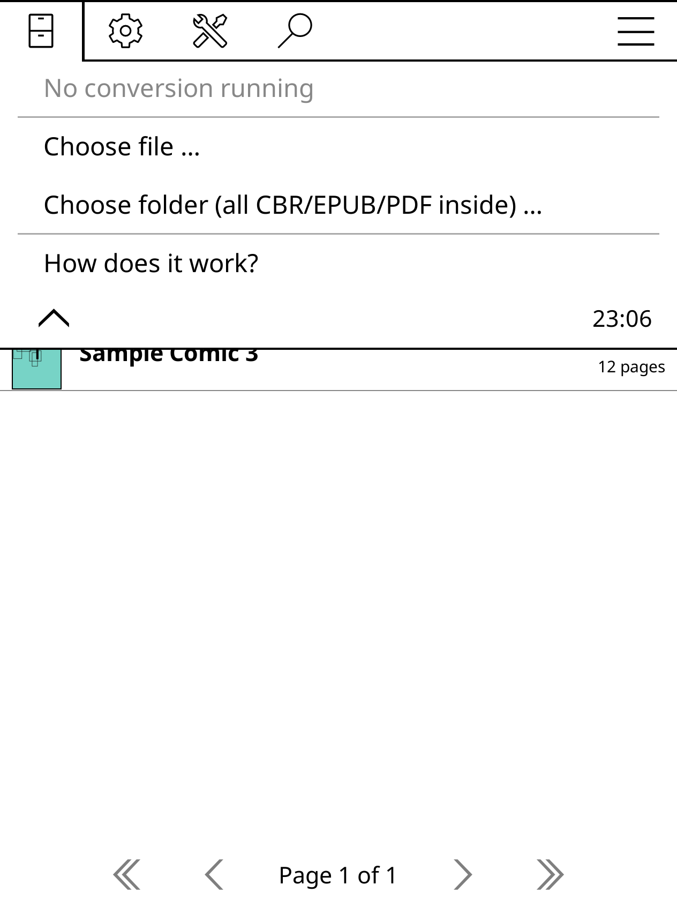
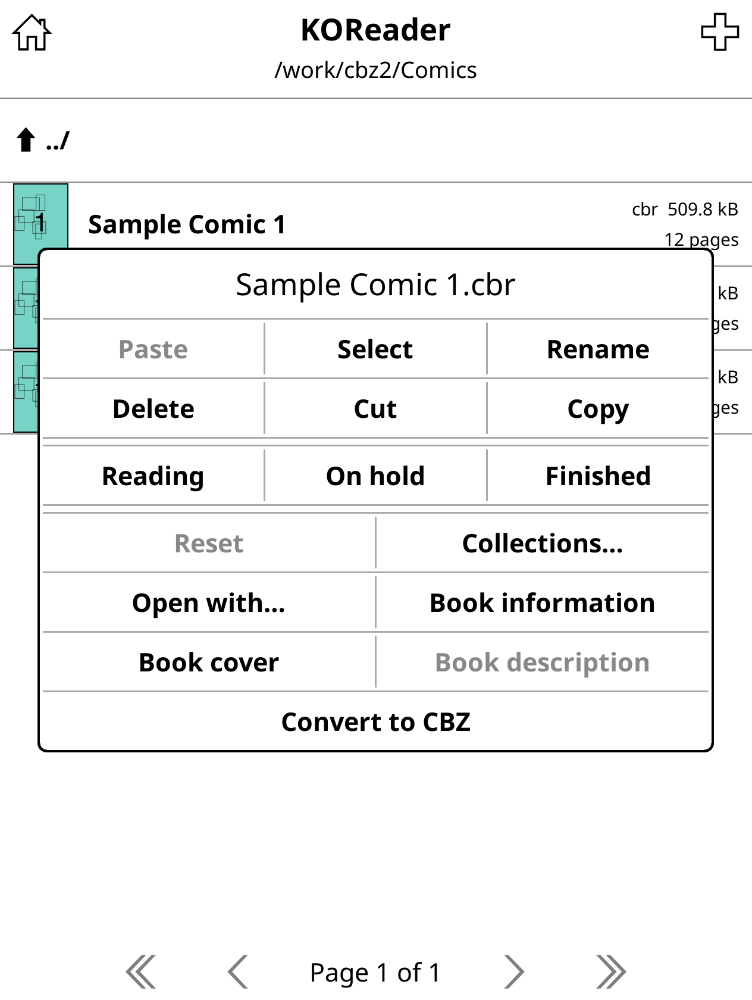
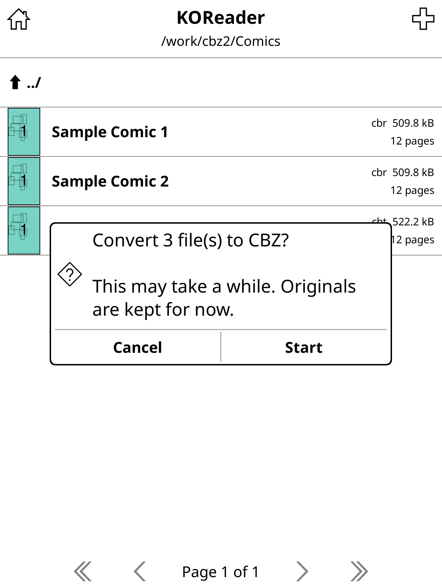
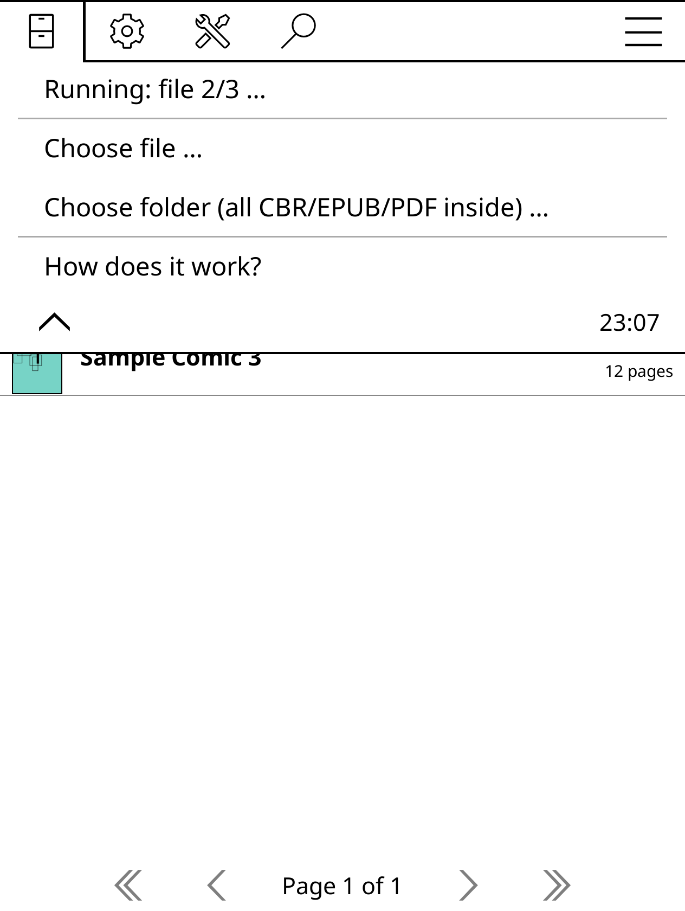
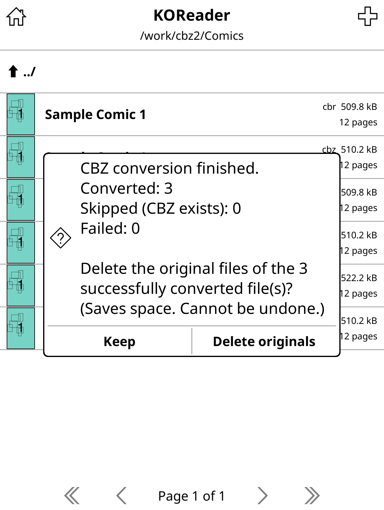
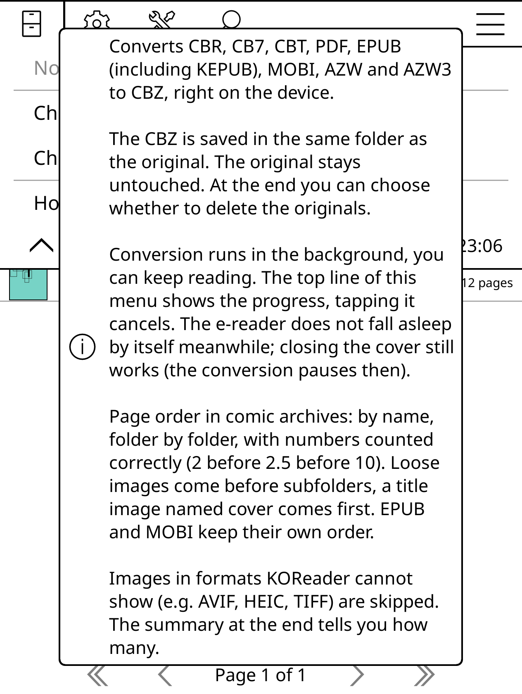

# CBZ-Konverter für KOReader

*English: [README.md](README.md)*

<!-- lang-note -->
*Funktioniert auf **Deutsch und Englisch**: Menüs und Texte richten sich nach der KOReader-Sprache.*

Ein KOReader-Plugin, das **CBR, CB7, CBT, PDF, EPUB (auch KEPUB), MOBI, AZW und AZW3** direkt auf dem E-Reader in **CBZ** umwandelt. Ein Computer ist nicht nötig. Die CBZ landet neben dem Original, das Original bleibt erhalten.

**Bonus:** Denselben Konverter gibt es auch für [Windows und Mac](#bonus-windows-und-mac), um ganze Sammlungen am Rechner umzuwandeln.

## Bildschirmfotos

*Die Bildschirmfotos zeigen die englische Oberfläche; in einem deutschen KOReader sind die Texte deutsch.*

<table>
<tr><td align="center" valign="top" width="33%"> Werkzeuge-Menü: CBZ-Konverter</td><td align="center" valign="top" width="33%"> Langes Drücken auf eine Datei: In CBZ umwandeln</td><td align="center" valign="top" width="33%"> Rückfrage bei mehreren Dateien</td></tr>
<tr><td align="center" valign="top" width="33%"> Statuszeile während der Umwandlung</td><td align="center" valign="top" width="33%"> Zusammenfassung und Frage nach den Originaldateien</td><td align="center" valign="top" width="33%"> Hilfetext</td></tr>
</table>

## Installieren

1. Die ZIP-Datei unter [Releases](../../releases) herunterladen und entpacken, oder dieses Projekt herunterladen.
2. Den Ordner **`cbzconverter.koplugin`** in KOReaders `plugins`-Ordner kopieren. Auf dem Kobo ist das `.adds/koreader/plugins/`. Der Ordner `.adds` ist versteckt: Am Mac im Finder `Cmd + Shift + .` drücken, unter Windows „Ausgeblendete Elemente“ einschalten.
3. KOReader neu starten.

Bei einem Update den ganzen Ordner `cbzconverter.koplugin` ersetzen, nicht einzelne Dateien.

## Benutzen

- **Einzelne Datei:** Im Dateimanager eine Datei **lang drücken** und **„In CBZ umwandeln“** antippen.
- **Über das Menü:** oberes Menü → Werkzeuge → **CBZ-Konverter** → „Datei wählen“ oder „Ordner wählen“. Die Ordner-Variante wandelt alles darin um, auch in Unterordnern.
- **Abbrechen:** Eine Meldung zeigt den Fortschritt. Ein Tipp auf den Bildschirm fragt „Abbrechen / Weiter“. Beim Abbrechen wird die unfertige CBZ gelöscht, das Original bleibt unberührt. Der Abbruch greift nach dem laufenden Schritt, bei PDFs nach der aktuellen Seite.
- **Originale löschen?** Am Ende fragt ein Fenster, ob die Originale der erfolgreich umgewandelten Dateien gelöscht oder behalten werden sollen. „Behalten“ ist die sichere Wahl. Gelöscht wird nur, wenn die neue CBZ vorhanden und nicht leer ist.
- Existiert die CBZ schon, wird die Datei übersprungen. Am Ende steht eine Zusammenfassung (umgewandelt / übersprungen / Fehler).
- **Sprache:** Deutsch oder Englisch, je nach KOReader-Sprache. Bei allen anderen Sprachen erscheint Englisch.

## Wie es arbeitet

- **CBR, CB7, CBT:** Die Bilder werden entpackt, natürlich sortiert (1, 2, 10 statt 1, 10, 2) und unverändert in eine CBZ gepackt. KOReader bringt libarchive mit, ein Zusatzprogramm ist nicht nötig.
- **EPUB:** Die Lesereihenfolge kommt aus dem EPUB selbst. Findet das Plugin sie nicht, sortiert es nach Dateinamen und sagt das.
- **MOBI, AZW, AZW3** (nur ohne Kopierschutz): Die Seitenbilder werden in Lesereihenfolge übernommen und unverändert gepackt. Das Mischformat MOBI+KF8 geht noch nicht.
- **PDF:** Jede Seite wird von KOReader als **JPG mit 1680 px Höhe** gerendert, Qualität 90. Das ist die Bildschirmhöhe des Kobo Libra Colour. Gemessen wird die Höhe, damit Einzel- und Doppelseiten gleich scharf werden. Niedrig aufgelöste PDFs werden **nicht hochgerechnet**: Das Plugin liest die Größe der ganzseitigen Bilder aus der PDF und rendert höchstens in dieser Höhe. Das Rendern dauert einige Sekunden pro Seite. `PDF_HEIGHT` und `PDF_QUALITY` oben in `cbz_converter.lua` lassen sich bei Speicherproblemen verkleinern.

## Grenzen

- Es funktionieren nur DRM-freie Dateien.
- Sehr große PDFs (100+ Seiten) dauern lange, also auf den Akku achten.
- Bei sehr großen Einzelbildern kann der Speicher knapp werden. Dann erscheint ein Fehler statt einer CBZ.

## Bonus: Windows und Mac

In [`extras/`](extras) liegt derselbe Konverter für den Rechner, mit denselben Regeln (1680 px, kein Hochrechnen, CBR/EPUB unverändert umgepackt):

| | Was es ist | Anleitung |
| --- | --- | --- |
| [`extras/windows`](extras/windows) | `Comics_zu_cbz.bat`, alles in einer Datei, mit Drag and Drop | [ANLEITUNG_Windows.md](extras/windows/ANLEITUNG_Windows.md) |
| [`extras/mac`](extras/mac) | `Comics zu CBZ.app`, eine Droplet-App (Quellcode in `Quellcode/`) | [ANLEITUNG_Mac.md](extras/mac/ANLEITUNG_Mac.md) |

Optionale Hilfsprogramme: [7-Zip](https://www.7-zip.org/) und [Poppler](https://github.com/oschwartz10612/poppler-windows/releases) unter Windows, am Mac `brew install poppler sevenzip`. Sie sind nicht Teil dieses Projekts.

## Testdateien

In [`testfiles/`](testfiles) liegt ein selbst erstellter Test-Comic mit 12 Seiten in jedem unterstützten Format, ohne fremde Inhalte.

## Getestet auf

- Kobo Libra Colour mit KOReader 2026.07.1 (auch mit ZenOS), mit allen Testdateien.
- Windows 11, mit und ohne Poppler.
- macOS: Die App wurde am Mac benutzt. Die letzte Änderung an `cbz.py` ist dort noch nicht getestet.

## Wer das gemacht hat

Der Code wurde vollständig von **Claude** geschrieben, einer KI von Anthropic: das Plugin und die Mac-Fassung von Claude am Mac, die Windows-Fassung, die Tests und die Korrekturen von Claude unter Windows. Der Inhaber dieses Projekts hatte die Idee, hat getestet und Rückmeldungen gegeben, aber keinen Code geschrieben.

Es gibt keine Garantie und keinen festen Support. Fehlermeldungen sind als [Issue](../../issues) willkommen. Bitte die `crash.log` aus dem KOReader-Ordner anhängen.

## Weitere Plugins

- [Comic Display](https://github.com/Akrota/koreader-comic-display): Refresh gegen Ghosting, dunkle Ränder und Uhr für Comics
- [Levels / Tonwerte](https://github.com/Akrota/koreader-comic-levels): Tonwertkurve für Comics
- [Comic Panel Zoom](https://github.com/Akrota/koreader-comic-panel-zoom): Panel-für-Panel-Ansicht (Fork von JorgeTheFox)
- [Comic Dual Page](https://github.com/Akrota/koreader-comic-dual-page): Doppelseiten mit Erkennung (Fork von KORComic)
- [Folder to series](https://github.com/Akrota/koreader-folder-to-series): Comic-Ordner zu Reihen mit Bandnummern
- [Drive Library](https://github.com/Akrota/koreader-drive-library): Google Drive als Cloud-Bibliothek
- [Story Recall](https://github.com/Akrota/koreader-story-recall): Spoilerfreier KI-Rückblick auf Bücher
- [Guitar Tab Reader](https://github.com/Akrota/koreader-guitar-tab-reader): Gitarren-Tabs und Chords für E-Ink
- [Wi-Fi while charging](https://github.com/Akrota/koreader-wifi-while-charging): WLAN anlassen, solange das Gerät lädt
- [Zen page browser gesture](https://github.com/Akrota/koreader-zen-page-browser-gesture): Geste für den ZenOS-Seitenbrowser

## Lizenz

[MIT](LICENSE). 7-Zip und Poppler sind eigene Programme mit eigenen Lizenzen.
