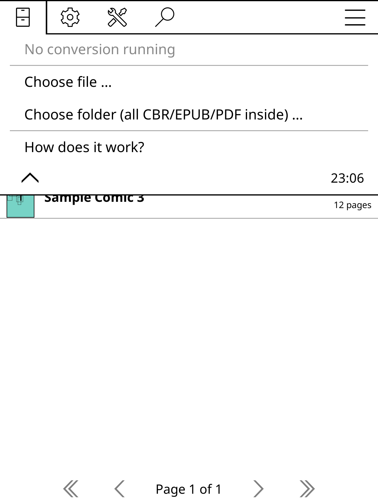
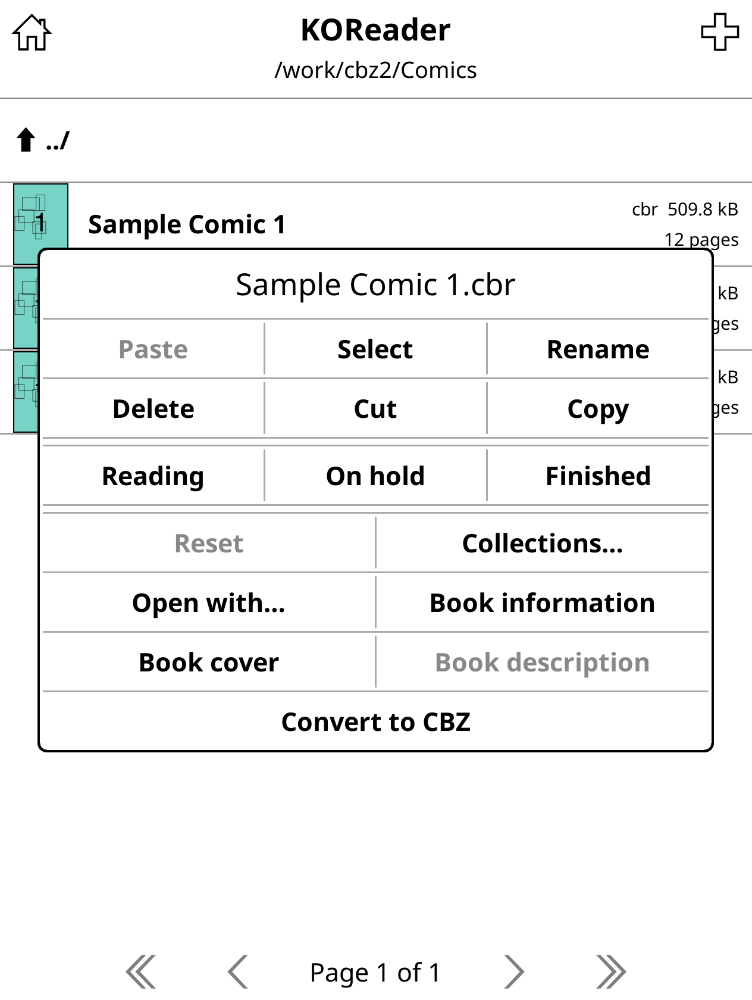
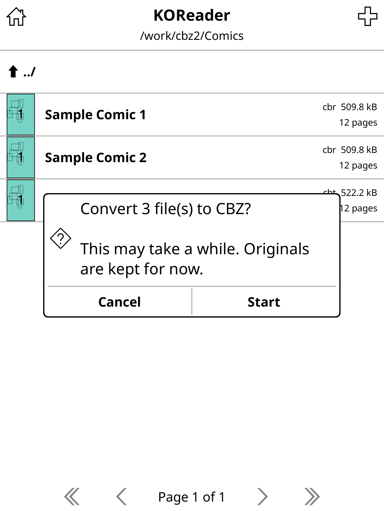
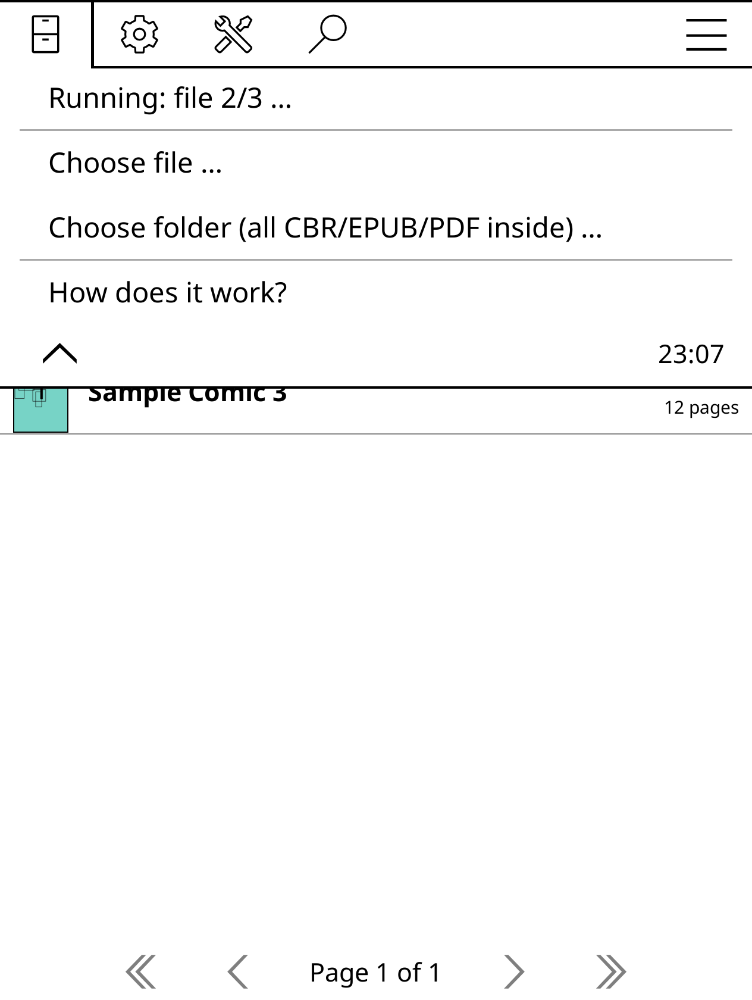
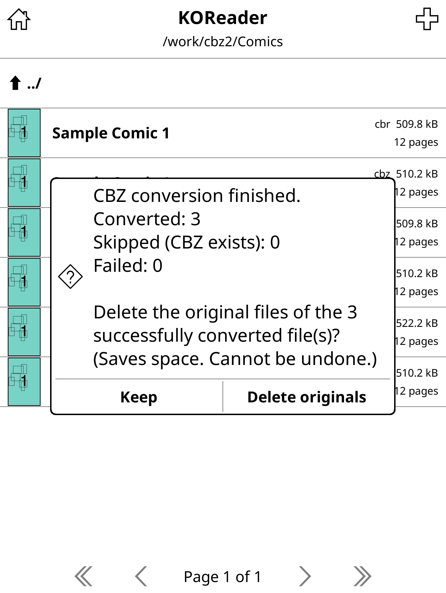
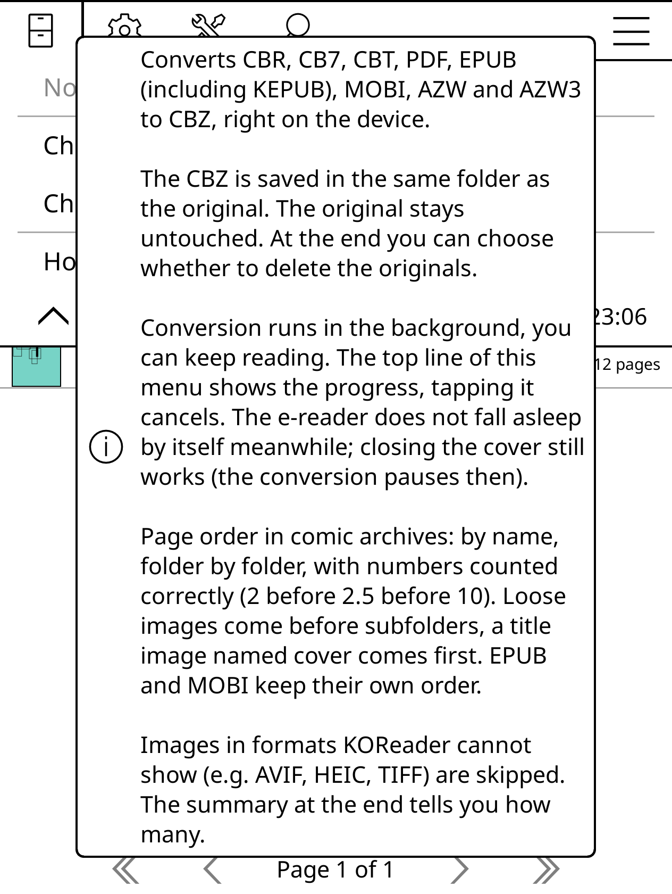

# CBZ converter for KOReader

*Deutsch: [README.de.md](README.de.md)*

<!-- byline -->
A plugin by **Akrota and Claude**.

<!-- lang-note -->
*Works in **English and German**: menus and texts follow KOReader's language. A German description is at the bottom of this page.*

A KOReader plugin that converts **CBR, CB7, CBT, PDF, EPUB (also KEPUB), MOBI, AZW and AZW3** to **CBZ** directly on your e-reader. No computer is needed. The CBZ is saved next to the original, and the original is kept.

**Bonus:** the same converter is also available for [Windows and Mac](#bonus-windows-and-mac), for converting whole collections on a computer.

## Screenshots

*The screenshots show the English interface; in a German KOReader the texts are German.*

<table>
<tr><td align="center" valign="top" width="33%"> Tools menu: CBZ converter</td><td align="center" valign="top" width="33%"> Long-press on a file: Convert to CBZ</td><td align="center" valign="top" width="33%"> Confirmation for several files</td></tr>
<tr><td align="center" valign="top" width="33%"> Status line while converting</td><td align="center" valign="top" width="33%"> Summary and the question about the original files</td><td align="center" valign="top" width="33%"> Help text</td></tr>
</table>

## Installation

1. Download the ZIP from [Releases](../../releases) and unpack it, or download this repository.
2. Copy the folder **`cbzconverter.koplugin`** to KOReader's `plugins` folder. On a Kobo, that is `.adds/koreader/plugins/`. The `.adds` folder is hidden: on a Mac press `Cmd + Shift + .` in Finder, on Windows turn on "Hidden items".
3. Restart KOReader.

When updating, replace the whole `cbzconverter.koplugin` folder, not single files.

## Usage

- **Single file:** in the file manager, **long-press** a file and tap **"Convert to CBZ"**.
- **Via the menu:** top menu → Tools → **CBZ converter** → "Choose file" or "Choose folder". The folder option converts everything inside, including subfolders.
- **Cancel:** a message shows the progress. Tapping the screen asks "Cancel / Continue". On cancel, the unfinished CBZ is deleted and the original stays untouched. The cancel takes effect after the current step (for PDFs, after the current page).
- **Delete originals?** At the end, a popup asks whether to delete or keep the originals of the successfully converted files. "Keep" is the safe choice. A file is only deleted if its new CBZ exists and is not empty.
- If the CBZ already exists, the file is skipped. A summary (converted / skipped / failed) is shown at the end.
- **Language:** German or English, depending on KOReader's language. Any other language falls back to English.

## How it works

- **CBR, CB7, CBT:** the images are unpacked, sorted naturally (1, 2, 10 instead of 1, 10, 2) and packed unchanged into a CBZ. KOReader ships with libarchive, so no extra program is needed.
- **EPUB:** the reading order comes from the EPUB itself. If the plugin can't find it, it sorts by file name and tells you.
- **MOBI, AZW, AZW3** (only without copy protection): the page images are taken in reading order and packed unchanged. The mixed MOBI+KF8 format isn't supported yet.
- **PDF:** each page is rendered by KOReader as a **JPG at 1680 px height** (the screen height of the Kobo Libra Colour) with quality 90. The plugin uses the height so that single pages and double-page spreads are equally sharp. Low-resolution PDFs are **not upscaled**: the plugin reads the size of the full-page images in the PDF and renders at most at that height. Rendering takes a few seconds per page. `PDF_HEIGHT` and `PDF_QUALITY` at the top of `cbz_converter.lua` can be lowered if memory runs short.

## Limits

- It only works with DRM-free files.
- Very large PDFs (100+ pages) take a long time, so keep an eye on the battery.
- Very large single images can run out of memory. You then get an error instead of a CBZ.

## Bonus: Windows and Mac

[`extras/`](extras) contains the same converter for computers, with the same rules (1680 px, no upscaling, CBR/EPUB repacked unchanged):

| | What it is | Guide |
| --- | --- | --- |
| [`extras/windows`](extras/windows) | `Comics_zu_cbz.bat`, everything in one file, with drag and drop | [GUIDE_Windows.md](extras/windows/GUIDE_Windows.md) |
| [`extras/mac`](extras/mac) | `Comics zu CBZ.app`, a droplet app (source code in `Quellcode/`) | [GUIDE_Mac.md](extras/mac/GUIDE_Mac.md) |

Optional helper programs: [7-Zip](https://www.7-zip.org/) and [Poppler](https://github.com/oschwartz10612/poppler-windows/releases) on Windows, and `brew install poppler sevenzip` on a Mac. They aren't part of this repository.

## Test files

[`testfiles/`](testfiles) contains a self-made 12-page test comic in every supported format, with no third-party content.

## Tested on

- Kobo Libra Colour with KOReader 2026.07.1 (also with ZenOS), with all test files.
- Windows 11, with and without Poppler.
- macOS: the app was used on a Mac. The latest change to `cbz.py` hasn't been tested there yet.

## Who made this

The code was written entirely by **Claude**, an AI by Anthropic: the plugin and the Mac version by Claude on a Mac, and the Windows version, testing and fixes by Claude on Windows. The owner of this repository came up with the idea, tested it and gave feedback, but did not write the code.

There is no warranty and no guaranteed support. Bug reports are welcome as [issues](../../issues). Please attach `crash.log` from the KOReader folder.

## More plugins by Akrota and Claude

- [Comic Display](https://github.com/Akrota/koreader-comic-display): Refresh against ghosting, dark borders and a clock for comics
- [Levels / Tonwerte](https://github.com/Akrota/koreader-comic-levels): Tone curve for comics
- [Comic Panel Zoom](https://github.com/Akrota/koreader-comic-panel-zoom): Panel-by-panel view (fork of JorgeTheFox's plugin)
- [Comic Dual Page](https://github.com/Akrota/koreader-comic-dual-page): Double pages with detection (fork of KORComic)
- [Folder to series](https://github.com/Akrota/koreader-folder-to-series): Comic folders to series with volume numbers
- [Drive Library](https://github.com/Akrota/koreader-drive-library): Google Drive as a cloud library
- [Story Recall](https://github.com/Akrota/koreader-story-recall): Spoiler-free AI recap for books
- [Guitar Tab Reader](https://github.com/Akrota/koreader-guitar-tab-reader): Guitar tabs and chords for e-ink
- [Wi-Fi while charging](https://github.com/Akrota/koreader-wifi-while-charging): Keep Wi-Fi on while charging
- [Zen page browser gesture](https://github.com/Akrota/koreader-zen-page-browser-gesture): Gesture for the ZenOS page browser

## License

[MIT](LICENSE). 7-Zip and Poppler are separate programs with their own licenses.

---

## Deutsch (Kurzbeschreibung)

Ein KOReader-Plugin, das **CBR, CB7, CBT, PDF, EPUB (auch KEPUB), MOBI, AZW und AZW3** direkt auf dem E-Reader in **CBZ** umwandelt. Ein Computer ist nicht nötig. Die CBZ landet neben dem Original, das Original bleibt erhalten.

**Bonus:** Denselben Konverter gibt es auch für [Windows und Mac](#bonus-windows-und-mac), um ganze Sammlungen am Rechner umzuwandeln.

### Benutzen

- **Einzelne Datei:** Im Dateimanager eine Datei **lang drücken** und **„In CBZ umwandeln“** antippen.
- **Über das Menü:** oberes Menü → Werkzeuge → **CBZ-Konverter** → „Datei wählen“ oder „Ordner wählen“. Die Ordner-Variante wandelt alles darin um, auch in Unterordnern.
- **Abbrechen:** Eine Meldung zeigt den Fortschritt. Ein Tipp auf den Bildschirm fragt „Abbrechen / Weiter“. Beim Abbrechen wird die unfertige CBZ gelöscht, das Original bleibt unberührt. Der Abbruch greift nach dem laufenden Schritt, bei PDFs nach der aktuellen Seite.
- **Originale löschen?** Am Ende fragt ein Fenster, ob die Originale der erfolgreich umgewandelten Dateien gelöscht oder behalten werden sollen. „Behalten“ ist die sichere Wahl. Gelöscht wird nur, wenn die neue CBZ vorhanden und nicht leer ist.
- Existiert die CBZ schon, wird die Datei übersprungen. Am Ende steht eine Zusammenfassung (umgewandelt / übersprungen / Fehler).
- **Sprache:** Deutsch oder Englisch, je nach KOReader-Sprache. Bei allen anderen Sprachen erscheint Englisch.

Die ausführliche deutsche Anleitung steht in der [README.de.md](README.de.md).
